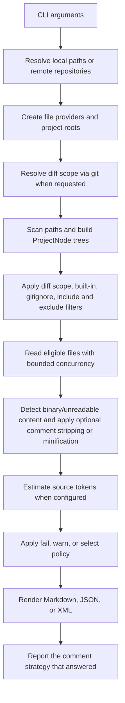

# Architecture and processing pipeline

Plutus is organized as a .NET solution with separate CLI, domain, infrastructure, and test projects.

## Projects

| Project | Responsibility |
|---|---|
| `Plutus.CLI` | Defines command-line arguments/options, validates CLI-level constraints, creates the service provider, and starts the application runner. |
| `Plutus.Domain` | Owns bundle workflow contracts, project-tree/scanning logic, ignore/comment-stripping/signature-extraction/minification abstractions, token estimation/policy, and Markdown/JSON/XML writers. It never references a parser, so the description of a transformation cannot depend on one implementation. |
| `Plutus.Infrastructure` | Supplies physical filesystem/path services, concrete ignore matchers, remote repository adapters, the parser-backed implementations (Roslyn for C# signatures), and dependency-injection registration. |
| `Plutus.Test` | Unit tests for scanners, writers, filters, comment strippers, signature extraction, minifiers, path/remote resolution, and token-budget behavior. |

## High-level pipeline

## Design notes

- **File-provider boundary:** Domain processing works through `IFileProvider`/`IFileInfo` abstractions rather than directly owning all filesystem operations. Infrastructure supplies the physical implementation.
- **Shared project tree:** The scanned `ProjectNode` graph feeds both directory-tree rendering and bundle serialization, reducing duplicate traversal and keeping tree status aligned with processing results.
- **Writer strategy:** `IBundleWriter` implementations own format-specific serialization while sharing common file reading, size checks, optional minification, token policy, and status propagation in `BaseBundleWriter`.
- **Remote-provider strategy:** `IRemoteRepository` adapters encapsulate provider-specific URL recognition, ref selection, archive URL construction, download, and extraction for GitHub, GitLab, and Bitbucket.
- **Token-budget strategy:** `ITokenBudgetApplier` isolates the optional budget policy. `NoOpTokenBudgetApplier` represents the disabled path; `TokenBudgetApplier` estimates and selects whole files when enabled.
- **Diff-scope strategy:** `IGitDiffContextProvider` reports what changed and returns `null` when scoping does not apply. A diff is split into one `DiffChunk` per file by `GitDiffChunker`, which is what lets the size and token limits act per change instead of discarding the whole set. `ChangedFileMapper` is the single place that turns repository-relative git paths into root-relative paths — for the chunk paths and for the paths inside the patch text — so a bundle rooted at a subdirectory reports only its own changes.
- **Content mode:** `IBundleWriter.IncludeFileContents` separates "review the change" (`--diff-only`: paths plus per-file diffs) from "bundle the changed source" (`--diff-from`: contents plus diffs). It is a writer concern, so the scanner, filters and token policy behave identically in both modes.
- **One budget, two payloads:** `TokenBudgetSelector` owns the whole-file selection rules, and both `TokenBudgetApplier` (content) and `DiffScopeLimiter` (diffs) use it, so `fail`, `warn`, `select` and the selection strategies cannot drift apart between the two paths. `DiffScopeLimiter` performs no I/O: the caller supplies file sizes.
- **Comment-stripping strategy:** `--strip-comments` and `--minify` share one pipeline. `ICommentStripper` is the seam: `LexicalCommentStripper` is a character scanner driven by an injected `LanguageCommentSyntaxTable`, while `AntlrCommentChannelStripper` drops tokens on a grammar's comment channels and refuses to rewrite a file whose tokens do not tile the input. `CommentStrippingPlanner` resolves the requested strategy against `GrammarInventory` (the grammars the project actually maintains) before any file is read, and `CommentStrippingReport` records which strategy answered per language so the run can print it. A language with no syntax entry is never scanned with another language's rules.
- **Structural pass:** `--signatures-only` runs a parse-tree transformation through `ISignatureSkeletonProvider`. The domain owns the contract, the token stream and `TokenStreamRewriter` — an ANTLR-shaped rewriter (replace, delete and insert over token indices) that refuses a stream which does not tile its source and throws on conflicting edits — while the C# provider lives in `Plutus.Infrastructure.Structure`: it parses with Roslyn, walks the tree with a `CSharpSyntaxWalker`, turns each implementation body into an inclusive token span, and applies the spans through the rewriter, so it can degrade to "leave the file unchanged, say why". `SourceProcessingContext` fixes the order of the passes: comments, then signatures, then whitespace. `ArchitectureTests` enforces the layering: the domain assembly references no parser and declares no provider.
- **Source-processing modes:** `SourceProcessingMode` distinguishes stripping comments from minifying: the whitespace pass, C# region removal, and the final trim happen only in `Minify` mode, which keeps `--strip-comments` byte-faithful outside the comments themselves.
- **Discovery over dispatch:** language processors (`IMaintainedLanguageProcessor`) and structural providers (`ISignatureSkeletonProvider`) declare the language they serve and are registered by the container scanning for their interface. `LanguageMinifierCatalog` (a service) fills in every other language from the syntax table and rejects a language claimed twice, so no switch over language identifiers exists in the code.
- **Language identity:** `LanguageId` is a normalized value type rather than a loose string, so lookups need no comparer, a misspelled identifier cannot silently miss a table entry, and the canonical spellings live in one place.
- **One output target:** services report progress, warnings and errors through `IRunOutput` instead of writing to the console, and the bundler records its numbers in `BundleRunReport` instead of printing them. The host binds the target (`ConsoleRunOutput` for the CLI, `NullRunOutput` for a library caller or a test) and `IRunReportWriter` renders the whole run report in one place, so the wording, the alignment and the number culture cannot drift between layers.
- **Services over static helpers:** behavior lives in injectable classes — `LanguageCommentSyntaxTable`, `LexicalCommentStripper`, `LanguageMinifierCatalog`, `CodeMinifierFactory`, `CommentStrippingPlanner`, `GrammarInventoryLoader`, `RunReportWriter` — so a dependency is visible in a constructor signature, a test builds the object with exactly the collaborators it is about, and a host can substitute any of them. What stays static is data and value semantics: constants, immutable defaults (`CommentStripOptions.Default`, `SourceProcessingContext.Disabled`), the null-object `NullRunOutput.Instance`, pure identifier mapping (`CommentStrategyNames`) and validating factories for value types (`CodeTokenStream.TryCreate`).
- **Dependency injection:** `Plutus.Infrastructure` registers the concrete services consumed by the CLI runner; `ServiceCollectionTests` builds the container with scope and build validation, so an unresolvable service or a lifetime mismatch fails a test rather than a run.

## Error and omission semantics

A file can be absent from embedded source content for different reasons: it exceeds `--max-file-size`, is detected as binary, cannot be read, or is omitted by token-budget selection. These are distinct outcomes and should remain distinguishable in output status/skip metadata and tests.

A diff can be absent for the same reasons, and the diff sections state which one applied instead of dropping the change silently. Because each diff is its own chunk, an omission affects one file and never the whole change set.

## Testing approach

Tests use file-provider abstractions and test file-info implementations to exercise core behavior without requiring a real repository for every case. When changing pipeline behavior, prefer a focused unit test plus an end-to-end CLI test when the behavior crosses multiple layers.

Comment stripping is additionally tested against real-world fixtures under `Plutus.Test/Fixtures/Comments`; where a fixture's own parser is on `PATH` (`node`, `python`, `gcc`), the stripped output is handed to it so the result is verified by something other than the scanner under test.

Signature extraction is tested against a real fixture (`Plutus.Test/Fixtures/Structure/Service.cs`) plus unit tests for interfaces, abstract members, generics with constraints, expression and accessor bodies, and for the token rewriter's refusal to apply conflicting edits.
